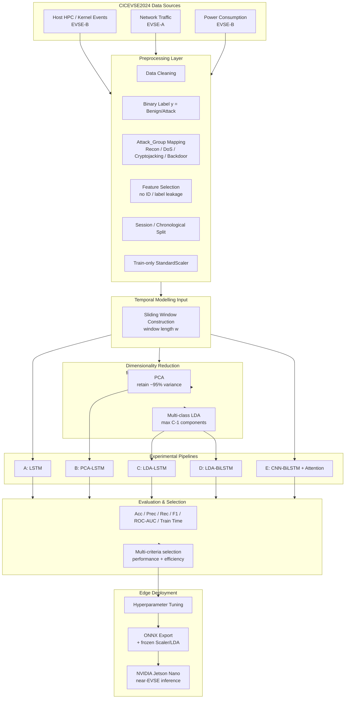
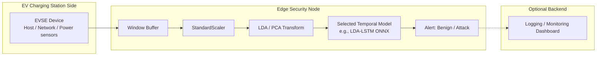

# System Architecture Diagram

**Figure suggestion title:**  
*System architecture of the proposed supervised dimensionality-reduction and temporal deep-learning framework for EVSE attack detection.*

Static figure file: `thesis_figures/system_architecture.png`

---

## 1) Overall system architecture (Mermaid)

---

## 2) Deployment / runtime architecture (Mermaid)

---

## 3) Caption text for thesis/journal

> **Figure X.** System architecture of the proposed framework. Multimodal CICEVSE2024 telemetry (host HPC/kernel events, network traffic, and power consumption) is cleaned and labelled, split with a leakage-aware protocol, and converted into temporal windows. PCA and multi-class LDA are fitted on training data only. Five temporal deep-learning pipelines (A–E) are trained and compared using detection and efficiency metrics. The selected model is optimized and deployed on an NVIDIA Jetson Nano for near-EVSE edge inference.

---

## 4) Layer summary (for text around the figure)

| Layer | Function |
|---|---|
| Data sources | Host, network, and power modalities from CICEVSE2024 |
| Preprocessing | Cleaning, binary + family labels, leakage-safe features, split, scaling |
| Sequence construction | Sliding windows for temporal models |
| Dimensionality reduction | Train-only PCA and multi-class LDA |
| Pipelines A–E | Controlled temporal DL comparison |
| Evaluation & selection | Accuracy/F1/AUC vs computational cost |
| Edge deployment | Tuned model + ONNX/TensorRT on Jetson Nano |
